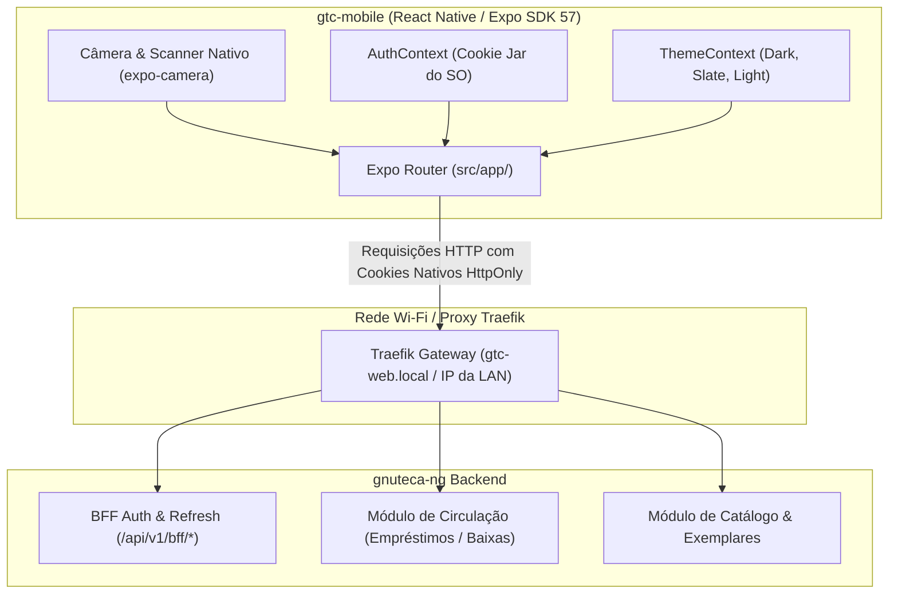

# 📱 GTC-Mobile — Aplicativo Móvel de Circulação & Scanner

[](https://expo.dev/)
[](https://reactnative.dev/)
[](https://react.dev/)
[](https://docs.expo.dev/router/introduction/)
[](https://www.typescriptlang.org/)
[](https://docs.expo.dev/versions/latest/sdk/camera/)
[](https://auth0.com/blog/the-backend-for-frontend-pattern-guides-modern-web-development/)
[](LICENSE)

> **Aplicativo móvel oficial do ecossistema Gnuteca: transforma smartphones e coletores Android/iOS em balcões de atendimento móvel para circulação rápida, inventário e leitor de código de barras.**

---

## 📑 Tabela de Conteúdos

- [Visão Geral & Contexto](#-visão-geral--contexto)
- [Arquitetura Móvel & Comunicação com o BFF](#-arquitetura-móvel--comunicação-com-o-bff)
- [Principais Funcionalidades](#-principais-funcionalidades)
- [Design System & Paridade com a Web](#-design-system--paridade-com-a-web)
- [Stack Tecnológica & Pré-requisitos](#-stack-tecnológica--pré-requisitos)
- [Guia de Início Rápido (Quickstart)](#-guia-de-início-rápido-quickstart)
- [Estrutura de Diretórios](#-estrutura-de-diretórios)
- [Qualidade de Código & Tipagem](#-qualidade-de-código--tipagem)
- [Contratos de API & Invariantes](#-contratos-de-api--invariantes)
- [Estado Atual & Roadmap](#-estado-atual--roadmap)
- [Padrões de Governança & Commits](#-padrões-de-governança--commits)
- [Licença](#-licença)

---

## 🌐 Visão Geral & Contexto

O **`gtc-mobile`** foi concebido para libertar bibliotecários e operadores do balcão fixo de atendimento. Com ele, as tarefas de inventário físico nas estantes, empréstimo volante, baixa rápida de devoluções e verificação de tombos ocorrem diretamente através do smartphone ou coletor de dados:



---

## 🏛️ Arquitetura Móvel & Comunicação com o BFF

1. **Expo Router (File-based Navigation)**:
   - Estrutura hierárquica de navegação por abas e telas modais sob `src/app/`.
   - Gerenciamento automático de transições de tela e adaptação à área segura (*Safe Area*).
2. **Gerenciamento de Sessão Seguro (Zero-Token)**:
   - O aplicativo **não** persiste tokens JWT manualmente em `AsyncStorage`.
   - A comunicação é intermediada pelo cliente Axios (`src/services/api.ts`) utilizando o **Cookie Jar nativo do sistema operacional** (`NSURLSession` no iOS e `OkHttpClient` no Android).
   - O BFF do backend gerencia e renova os cookies HttpOnly (`SID_ACC` e `SID_REF`) com interceptador de auto-renovação em status HTTP 401.
   - *Evolução planejada:* Suporte a OAuth2 Code + PKCE com Casdoor IAM armazenando tokens em `expo-secure-store` (conforme detalhado no [`ROADMAP-12FACTOR.md`](../ROADMAP-12FACTOR.md)).

---

## ✨ Principais Funcionalidades

* 📷 **Leitor de Código de Barras Integrado (`expo-camera`)**:
  - Escaneamento em tempo real de códigos EAN-13, Code 128, Code 39 e QR Codes.
  - Leitura instantânea de tombos físicos de exemplares e carteirinhas/crachás de leitores.
* 🔄 **Balcão Volante de Circulação**:
  - Empréstimo móvel: associação rápida entre Leitor e Exemplar em duas leituras consecutivas.
  - Devolução instantânea com baixa no acervo e verificação imediata de pendências/multas.
* 🔍 **Consulta Rápida de Exemplar**:
  - Exibe situação do exemplar, localização física na biblioteca (unidade e estante) e histórico imediato de circulação.
* 👤 **Área do Leitor & Carteirinha Digital**:
  - Exibição de dados institucionais, histórico de empréstimos e código de barras na tela para validação em catracas.

---

## 🎨 Design System & Paridade com a Web

O `gtc-mobile` mantém paridade estrita de identidade visual com o portal web [`gtc-web`](../gtc-web/README.md):

* **Componente [`GtcIcon`](src/components/icons/GtcIcon.tsx) Exclusivo**: Utiliza o mesmo catálogo vetorial SVG inline baseado em `react-native-svg`, eliminando o overhead de fontes de ícones pesadas.
* **3 Temas Visuais Dinâmicos (`useTheme`)**:
  - 🌙 **Escuro Profundo (`dark`)**: Otimizado para telas OLED e economia de bateria.
  - 🌫️ **Slate Intermediário (`intermediate`)**: Tons suaves de ardósia para iluminação interna de bibliotecas.
  - ☀️ **Claro (`light`)**: Contraste elevado para uso sob luz natural intensa.

---

## 🛠️ Stack Tecnológica & Pré-requisitos

* **Node.js** `>= 20.x`
* **Expo SDK 57+**
* **React Native 0.86+** & **React 19.2**
* **Expo Router v57** (Navegação baseada em arquivos)
* **expo-camera** (Captura e decodificação óptica de códigos)
* **react-native-svg** (Renderização vetorial SVG nativa)
* **Axios** com suporte a credenciais e cookies nativos de rede
* **TypeScript 6.x** com modo estrito

---

## 🚀 Guia de Início Rápido (Quickstart)

### 1. Inicialização Integrada via Bundle (Recomendado)
Na raiz do repositório [`gtc-bundle`](../README.md):

```bash
# Iniciar o container do app mobile:
./gtc.sh up gtc-mobile

# Visualizar logs e QR Code do Metro Bundler:
./gtc.sh logs gtc-mobile
```

### 2. Execução Local no Computador
Dentro da pasta `gtc-mobile/`:

```bash
# 1. Instalar dependências:
npm install

# 2. Iniciar o servidor Metro Bundler:
npm run start
```

No terminal, pressione:
* `a` para abrir no emulador Android
* `i` para abrir no simulador iOS (macOS)
* `w` para abrir a pré-visualização web no navegador
* Ou escaneie o **QR Code** no terminal usando o aplicativo **Expo Go** em seu dispositivo móvel físico conectado à mesma rede Wi-Fi.

---

## 📁 Estrutura de Diretórios

```text
gtc-mobile/
├── assets/                  # Ícones adaptativos, splash screen e imagens
├── docs/                    # Especificações técnicas (SPEC.md) e roadmap (PLAN.md)
├── src/
│   ├── app/                 # Rotas e Telas do Expo Router
│   │   ├── _layout.tsx      # Layout raiz com ThemeProvider e AuthProvider
│   │   ├── (tabs)/          # Navegação por abas inferiores
│   │   │   ├── index.tsx    # Tela inicial / Dashboard de operações
│   │   │   ├── scanner.tsx  # Câmera e Scanner de código de barras
│   │   │   ├── loans.tsx    # Circulação e empréstimos volantes
│   │   │   └── profile.tsx  # Perfil do operador / carteirinha
│   │   └── login.tsx        # Tela de login com validação Zod
│   ├── components/
│   │   └── icons/           # Catálogo vetorial SVG GtcIcon
│   ├── contexts/            # Contextos React (AuthContext e ThemeContext)
│   ├── services/            # Cliente HTTP Axios configurado para o BFF
│   └── styles/              # Paletas e tokens visuais (Dark, Slate, Light)
├── app.json                 # Manifesto de configuração do Expo
├── package.json             # Dependências e scripts do projeto
└── tsconfig.json            # Configurações TypeScript estritas
```

---

## 🧪 Qualidade de Código & Tipagem

```bash
# 1. Checagem estática de tipos TypeScript (0 erros tolerados):
npx tsc --noEmit

# 2. Análise de linter ESLint:
npm run lint

# 3. Execução a partir do orquestrador gtc-bundle:
./gtc.sh lint gtc-mobile
./gtc.sh test gtc-mobile
```

---

## 🔒 Contratos de API & Invariantes

1. **Paridade Design System**: O catálogo `GtcIcon` e a paleta de cores mantêm correspondência de 1:1 com o portal web [`gtc-web`](../gtc-web/README.md).
2. **Sessão Segura**: Proibido armazenar credenciais ou JWT em texto puro no `AsyncStorage`. A sessão utiliza cookies nativos ou SecureStore com biometria.
3. **EAS Build & Update**: Conforme planejado no [`ROADMAP-12FACTOR.md`](../ROADMAP-12FACTOR.md), compilações para as lojas utilizam **EAS Build** e atualizações OTA utilizam política de `runtimeVersion` estrita para prevenir quebras com binários antigos.

---

## 🗺️ Estado Atual & Roadmap

> Fonte canônica: [`docs/PLAN.md`](./docs/PLAN.md).

### ✅ Módulos Concluídos
- [x] **Épico 1: Autenticação & Sessão BFF** (Axios com credenciais, `AuthContext`, tela de login Zod e proteção de rota no layout raiz).
- [x] **Suporte a 3 Temas Visuais** (Dark, Slate e Light com hook `useTheme`).
- [x] **Catálogo Vetorial SVG GtcIcon** (Paridade total com a web).

### ⏳ Próximo Passo Imediato (Épico 2)
- [ ] Implementar tela de Scanner (`scanner.tsx`) com `expo-camera` para captura de tombos físicos e carteirinhas.
- [ ] Construir o fluxo de Empréstimo Rápido e Devolução integrado aos endpoints de Circulação do backend.
- [ ] Adicionar feedback tátil (*haptic feedback*) e sonoro na leitura de códigos.

---

## 📜 Padrões de Governança & Commits

Commits no repositório utilizam a convenção semântica padronizada com emojis (ver `prompts/commit-message.md`):
* `✨ Adiciona`: Novas telas móveis, fluxos de scanner ou componentes
* `🐛 Corrige`: Resolução de bugs no scanner, autenticação ou estilos
* `🔧 Refatora`: Melhorias em hooks, navegação e consumo de API
* `📱 Mobile`: Ajustes específicos para comportamento Android ou iOS

---

## 📄 Licença

Distribuído sob a licença **Apache 2.0**.
